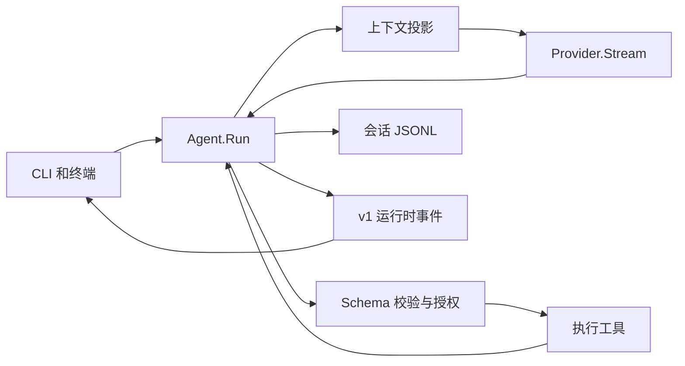

# Arc 架构

Arc 把模型请求、工具执行、持久化和终端渲染分开。`cmd/arc` 注册进程信号，`internal/cli` 读取配置并组装组件，`internal/arc` 提供运行时。理解代码时，可以从 `cli.launch` 跟到 `Agent.Run`，再沿一条工具调用读到 `Session.Append`。

## 一次任务

1. `Agent.Run` 持久化用户消息并开始一轮。输入预算包含系统提示、指令、历史消息和工具 Schema。
2. `Provider.Stream` 将消息转换成 Chat Completions 请求。它直接用 `net/http` 连接目标端点，逐个读取 SSE 事件。正文增量交给终端，工具提案只在终止原因、`[DONE]` 和完整参数验证通过后返回。
3. `Registry` 按工具名查找工具并使用 Draft 2020-12 校验参数。授权依据是 tool effect 和用户选择的 policy。用户审批通过后才能执行 Hook 和工具。
4. Arc 按顺序执行一批工具。完整结果先写入会话，再发给终端或 JSONL 消费者。模型下一轮能看到这批结果。
5. Steering 在下一轮前合入，follow-up 在工具循环自然结束前转为下一轮。取消通过 `context.Context` 传递，未完成的工具调用留下带错误的配对结果。

## 会话和上下文

`session.go` 沿用 v1 JSONL 格式。`message` 和 `checkpoint` 记录有 `id` 和 `parent`，`cursor` 记录当前分支。`title` 记录只修改标题。写入者持有排他锁，每条追加记录写入后同步；遇到损坏的记录时停止加载并保留原文件。

读取当前历史时，代码从叶节点沿父指针向上遍历。工具批次中缺少的结果用中断消息补齐。这个过程没有工具执行入口。归档在持有写锁时将整个文件移动到工作区的归档目录。

`context.go` 把当前分支投影为 Provider 能接收的消息。历史裁剪按用户轮次划分，必要时只缩短送给模型的工具输出。成功的摘要作为新检查点追加，原始消息仍可从旧节点恢复。估算预算用于控制输入规模，实际 token 计费来自 Provider 返回的用量。

## 权限和终端

`config.go` 将凭据保留在用户确认的模型端点，项目配置只能选择已有 Provider 和模型。Bash 环境另行过滤 Provider 凭据和其他敏感变量。结构化文件工具使用 `os.Root`。`bash.go` 启动独立进程组，并在结束、取消或超时时清理仍在组内的子进程。

终端用 Bubble Tea 管理输入、状态和输出。任务在 goroutine 中运行，通过事件通道与终端交换状态。审批使用独立的应答通道，避免把审批输入发给模型。正文按完整行提交到滚动记录，没有换行的尾部留在当前视图中。

阅读测试时，可以从 `internal/arc/agent_test.go` 的脚本化 Provider 开始，再看 `internal/cli/cli_test.go` 中的本地 HTTP 服务与真实 PTY。
